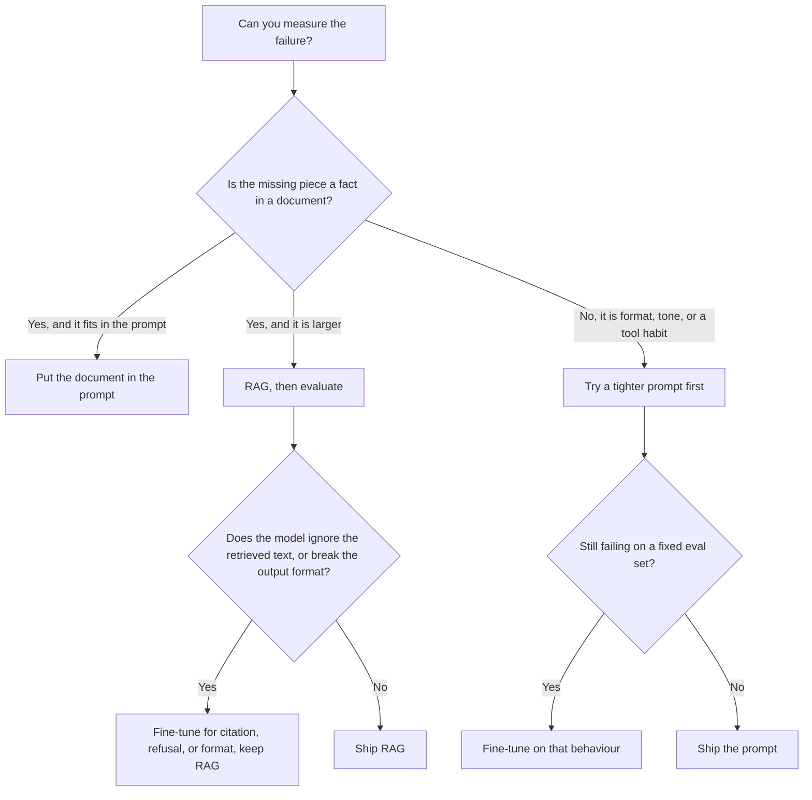

# RAG versus fine-tuning

Retrieval-augmented generation (RAG) looks up text at question time and stuffs the relevant excerpts into the prompt. Fine-tuning changes the model's weights, usually so it follows a format, a tone, or a task more reliably.

They solve different problems. You can also combine them. This page puts official guidance, a few papers, and real practitioner comments next to each other, including the places where those sources disagree.

Based on November 2026 internet data. Reddit comments are quoted from threads that were fetched for this workshop. Nothing here is invented.

## A short rule of thumb

- Use **RAG** (or a long prompt) for facts that live in documents and can change: policies, tickets, runbooks, repo files, prices, dates.
- Use **fine-tuning** for habits the model should have without being reminded every time: a strict JSON footer, a house writing style, when to call a tool, a shorter system prompt, or teaching a smaller model to match a larger one on one task.
- Use **both** when you want the habit and the facts: a model that always cites policy IDs, plus a retriever that supplies the current policy text.

If the knowledge base is small enough to fit in the prompt, start there. Anthropic's Contextual Retrieval write-up puts the cutoff at about **200,000 tokens, or roughly 500 pages**. Below that, "put it all in the prompt." Above that, retrieve.

The [Qwen 3.5 demo](qwen-finetune-demo/README.md) in this folder is a fine-tune of the habit (policy Q&A with a strict JSON footer). The [PDF example](../using-local-models/examples/README.md) is RAG. They are meant to be compared, not treated as rivals.

## What official sources say

### OpenAI: weights are long-term memory, inputs are short-term

The OpenAI cookbook page [Question answering using embeddings-based search](https://cookbook.openai.com/examples/question_answering_using_embeddings) (the current home of the older "Why search is better than fine-tuning" note) describes two ways a model can "learn" a fact:

- Through **model weights** (fine-tuning).
- Through **model inputs** (putting the fact in the prompt, which is what RAG does).

It then says fine-tuning is a poor way to teach knowledge:

> Although fine-tuning can feel like the more natural option — training on data is how GPT learned all of its other knowledge, after all — we generally do not recommend it as a way to teach the model knowledge. Fine-tuning is better suited to teaching specialized tasks or styles, and is less reliable for factual recall.
>
> As an analogy, model weights are like long-term memory. When you fine-tune a model, it's like studying for an exam a week away. When the exam arrives, the model may forget details, or misremember facts it never read. In contrast, input messages are like short-term memory. When you insert knowledge into an input message, it's like taking an exam with open notes.

That analogy is the one most later guides repeat. The same cookbook still treats fine-tuning as useful for format and style.

OpenAI's [model optimization](https://platform.openai.com/docs/guides/model-optimization) guidance, in the same spirit, starts with evals, then prompting, then fine-tuning when you need more examples than a prompt can hold, a shorter prompt at inference time, or a smaller model that still hits the bar.

### Anthropic: fit it in the prompt first, then retrieve

[Anthropic's Contextual Retrieval](https://www.anthropic.com/research/contextual-retrieval) piece is about making RAG better (contextual embeddings plus BM25, with an optional reranker). The practical sizing advice is the useful bit here: if the corpus is under about 200,000 tokens, put the whole thing in the prompt. If it is larger, retrieve. Updates to the corpus then become a document update, not a training run.

### Hugging Face: grounding, recency, citations

The [smolagents RAG example](https://huggingface.co/docs/smolagents/examples/rag) frames retrieval as a way to ground answers in your files, keep them current, and attach citations, without retraining. That is the everyday engineering case: a wiki, a ticket export, a set of PDFs.

### Unsloth: they also say you can add knowledge

Unsloth's FAQ, "Is Fine-tuning Right For Me?", is more optimistic about knowledge than the OpenAI cookbook. Unsloth recommends combining RAG and fine-tuning, and they describe fine-tuning as a way to add domain knowledge as well as style. That is a real disagreement, not a wording difference. The papers below are closer to OpenAI on factual injection. If you follow Unsloth's "add knowledge" path, measure hallucinations on facts that were and were not in the training set, and keep a retriever in the loop anyway.

## What the papers add

**Ovadia, Brief, Mishaeli, and Elisha, ["Fine-Tuning or Retrieval?"](https://arxiv.org/abs/2312.05934)** (EMNLP 2024). They compare unsupervised fine-tuning against RAG for knowledge injection. RAG consistently beats unsupervised fine-tuning on the knowledge tests they ran. Combining the two sometimes helps, and is sometimes unstable.

**Zhang et al., [RAFT](https://arxiv.org/abs/2403.10131)** (2024). RAFT fine-tunes a model to *use* retrieved documents well. Training examples include the question, an oracle document, distractor documents, and a chain-of-thought answer that cites the right excerpt. The result is a model that is better at in-domain RAG, which is a different goal from memorising the documents.

**Gekhman et al., ["Fine-tuning happens in two stages"](https://arxiv.org/abs/2405.05904)** (2024). When supervised fine-tuning examples contain facts the base model does not already know, the model learns those examples slowly. Once it finally fits them, hallucinations on other new facts rise in a roughly linear way. The paper is a caution against treating SFT as a knowledge store.

Together: RAG is the default for facts; fine-tuning is the default for behaviour; "fine-tune so it already knows the handbook" is the experiment you should be most sceptical of.

## What practitioners say, in their own words

These are comments from public Reddit threads, quoted as written. Spelling and punctuation are the authors'. Scores are from the fetch used for this page.

### Fine-tuning for format and behaviour, not as a knowledge base

[u/davernow](https://www.reddit.com/r/LocalLLaMA/comments/1kyeo4z/when_to_finetune_llms_and_when_not_to_a_practical/) wrote a long practical guide on r/LocalLLaMA, "When to Fine-Tune LLMs (and When Not To)". The post is the kind of field note that matches the official advice above. On formatting:

> **JSON formatting**: Seen format accuracy jump from <5% to >99% with fine-tuning vs base model

And on knowledge:

> **What NOT to Use Fine-Tuning For**
>
> Adding knowledge really isn't a good match for fine-tuning. Use instead:
>
> * RAG for searchable info
> * System prompts for context
> * Tool calls for dynamic knowledge
>
> You can combine these with fine-tuned models for the best of both worlds.

In a later comment in the same thread, they added:

> Fine-tuning + RAG is great - I'm all for combining them. I'm just saying don't expect fine-tuning alone to solve knowledge problems. If you have to choose one, RAG or context are going to be easier and less error prone most of the time. There's no universal "right way", always eval and compare!

And on trying to bake facts into the weights anyway:

> Fine-tuning for knowledge gets pretty hairy pretty fast. One epoch and it's not going to learn it, enough epochs to reliably learn it and reproduce it and you're likely to regress quality in other ways.
>
> You can try it, but I'd suggest trying this in parallel: add an overview to the context (key terms, custom vocab, etc). Add longer knowledge via RAG.

### Company Q&A about policies and PDFs

In [Using Embeddings (RAG) vs Fine-tuning a model on new data](https://www.reddit.com/r/LocalLLaMA/comments/1fubl03/using_embeddings_rag_vs_finetuning_a_model_on_new/), the question was how to answer questions about a company's rules, over 30 pages of documents. [u/razer_psycho](https://www.reddit.com/r/LocalLLaMA/comments/1fubl03/using_embeddings_rag_vs_finetuning_a_model_on_new/) wrote:

> At my Company we only use rag. with fine-tuning the danger of halluzination ist to high and 30 Pages ist nothing we work with 400 MB of PDF Data.

[u/Paulonemillionand3](https://www.reddit.com/r/LocalLLaMA/comments/1fubl03/using_embeddings_rag_vs_finetuning_a_model_on_new/) put the behaviour point bluntly:

> fine tuning (in general) changes tone or makes it talk like a pirate. You can't reliably add knowledge that way. Yet.

### The same OpenAI cookbook, cited in the wild

In [Finetuning vs RAG + Instruction + Prompt](https://www.reddit.com/r/LocalLLaMA/comments/1c814p2/finetuning_vs_rag_instruction_prompt/), [u/vasileer](https://www.reddit.com/r/LocalLLaMA/comments/1c814p2/finetuning_vs_rag_instruction_prompt/) quoted the OpenAI cookbook (score 6) and then added their own cut:

> finetuning makes sense with the goal to train a model to gain skills, not knowledge,
>
> for example I prefer OpenHermes, and Dolphin finetunes, because it trains models to be more context-obedient and instruction-obedient than the originals, which is very valuable for RAG use-case,
>
> if your data is only for answering user's question and not making the model better at some task, then it doesn't make sense to finetune

That is a good description of what the demo in this folder is for: teach the model a skill (answer from policy, always emit the JSON footer, refuse when the policy is missing). It is not an attempt to replace the handbook.

### RAG updates when the files change

In r/LangChain, [RAG vs. Fine-Tuning](https://www.reddit.com/r/LangChain/comments/15voq6v/rag_vs_fine_tuning/), [u/salehxoxo](https://www.reddit.com/r/LangChain/comments/15voq6v/rag_vs_fine_tuning/) wrote:

> From what I've read, fine tuning is used to make a model behave in a specific manner or pattern. It doesn't guarantee accurate results for the questions regarding your own data. You'll also have to fine tune it again if the original data is edited which could be costly/time consuming.

[u/LetGoAndBeReal](https://www.reddit.com/r/LangChain/comments/15voq6v/rag_vs_fine_tuning/) was sharper, looking for a counter-example and not finding one:

> From what I gather, RAG is the only viable option here. For many months I’ve been on the lookout for any successful demonstration of fine-tuning being used in lieu of RAG for question answering, and have not seen a single one.

[u/machineko](https://www.reddit.com/r/LangChain/comments/15voq6v/rag_vs_fine_tuning/) argued for doing both well, rather than picking a side.

### Code repos: retrieve the files, do not train on every commit

In r/MachineLearning, [Fine Tuning or RAG for Coding](https://www.reddit.com/r/MachineLearning/comments/170mtzx/fine_tuning_or_rag_for_coding_d/), [u/Ok-Kangaroo-59](https://www.reddit.com/r/MachineLearning/comments/170mtzx/fine_tuning_or_rag_for_coding_d/) described a working repo assistant:

> What we ended up doing was ast parsing code to get a list of all functions, classes and declarations and then storing metadata like their file path and some info about the code type, embedding [...] And then doing some generic information retrieval based RAG pipelines.

A later comment in that thread (quoted by the original poster after the original was deleted) made the maintenance point: a codebase changes constantly, so you would have to tune constantly, and even then a smaller model is not reliably grounded in the actual files. RAG presents the current files at question time. If you also want house style, a small style fine-tune can sit on top of that retriever. The [code-repo prep script](scripts/README.md) in this folder follows the retrieve-the-files path, not "train on the whole monorepo."

## A working decision order

1. Write an eval set of real questions, with the answers you would accept, before you change anything.
2. Try a better prompt. If the facts fit, put them in the prompt.
3. If the corpus is larger or changes often, add RAG. The PDF example in this workshop is the minimum version of that.
4. If the model still breaks the format, ignores tools, or will not stay in role, fine-tune on those behaviours. The Qwen demo is the minimum version of that.
5. If you need both, train the habit (RAFT-style if you want citations) and keep retrieval for the facts.
6. Re-run the same eval after each change. Do not argue from a single lucky answer.

## Sources

- [OpenAI cookbook: Question answering using embeddings-based search](https://cookbook.openai.com/examples/question_answering_using_embeddings)
- [OpenAI model optimization](https://platform.openai.com/docs/guides/model-optimization)
- [Anthropic: Contextual Retrieval](https://www.anthropic.com/research/contextual-retrieval)
- [Hugging Face smolagents: RAG](https://huggingface.co/docs/smolagents/examples/rag)
- [Unsloth FAQ: Is Fine-tuning Right For Me?](https://docs.unsloth.ai/get-started/fine-tuning-llms-guide/faq)
- [Ovadia et al., Fine-Tuning or Retrieval?, arXiv:2312.05934](https://arxiv.org/abs/2312.05934)
- [Zhang et al., RAFT, arXiv:2403.10131](https://arxiv.org/abs/2403.10131)
- [Gekhman et al., arXiv:2405.05904](https://arxiv.org/abs/2405.05904)
- Reddit (fetched): [r/LocalLLaMA 1kyeo4z](https://www.reddit.com/r/LocalLLaMA/comments/1kyeo4z/when_to_finetune_llms_and_when_not_to_a_practical/), [1fubl03](https://www.reddit.com/r/LocalLLaMA/comments/1fubl03/using_embeddings_rag_vs_finetuning_a_model_on_new/), [1c814p2](https://www.reddit.com/r/LocalLLaMA/comments/1c814p2/finetuning_vs_rag_instruction_prompt/), [r/LangChain 15voq6v](https://www.reddit.com/r/LangChain/comments/15voq6v/rag_vs_fine_tuning/), [r/MachineLearning 170mtzx](https://www.reddit.com/r/MachineLearning/comments/170mtzx/fine_tuning_or_rag_for_coding_d/)
