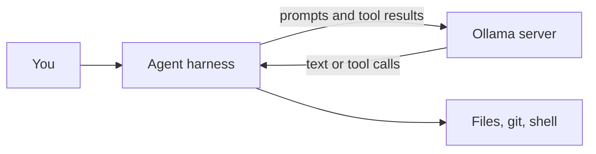

# Chat versus agent harnesses

Ollama serves a model. A chat window sends one prompt and prints the reply. An agent harness wraps that model in a loop: it gives the model tools, runs those tools against your files and terminal, and feeds the results back until the task is done.

Based on November 2026 internet data.

If you only need a local endpoint for a script, stay on the [Ollama guide](ollama-guide.md) and the [examples](examples/README.md). This page is about the official coding harnesses that Ollama can launch or talk to.

## The three layers, applied to a coding tool



- **Ollama** loads the weights and predicts tokens. It does not edit `app.py`.
- **The harness** (Claude Code, Codex CLI, OpenCode, Hermes Agent, and the others below) owns the loop, the tool list, the permission prompts, and the working tree.
- **The model** decides what to do next, in the format the harness expects.

This is why context length matters so much for agents. Tool schemas and file contents sit at the front of the prompt. Ollama's default context on a machine under 24 GiB is 4,096 tokens, which will truncate that prefix. Set `OLLAMA_CONTEXT_LENGTH=65536` (or at least `32768`) before you point a harness at a local model. See [Loading and unloading models](ollama-guide.md#loading-and-unloading-models-from-ram) if the model then no longer fits.

## Official `ollama launch` targets

`ollama launch` installs or configures a supported client and points it at your local server. The exact flags live in the [integrations index](https://docs.ollama.com/integrations). The launch targets documented alongside Ollama v0.40 include:

| Target | Command shape | What it is |
| --- | --- | --- |
| Claude Code | `ollama launch claude --model qwen3.8:27b` | Anthropic's terminal coding agent, talking to Ollama's Anthropic-compatible `/v1/messages` API. |
| Codex CLI | `ollama launch codex --model ...` | OpenAI's Codex command-line agent, pointed at Ollama's OpenAI-compatible `/v1` API. |
| OpenCode | `ollama launch opencode --model ...` | Open-source terminal coding agent. |
| Cline | `ollama launch cline --model ...` | VS Code coding agent. |
| Droid | `ollama launch droid --model ...` | Factory's Droid agent. |
| Qwen Code | `ollama launch qwen --model ...` | The Qwen coding CLI, useful when you are already on a Qwen model. |
| DeepSeek Harness | `ollama launch dsh --model ...` | DeepSeek's coding harness. |
| Hermes Agent | `ollama launch hermes --model ...` | Nous Research's Hermes Agent. It expects the OpenAI-compatible endpoint at `http://127.0.0.1:11434/v1`. |
| OpenClaw | `ollama launch openclaw --model ...` | OpenClaw agent integration. |

Desktop and IDE companions in the same integrations list include Claude Desktop, ChatGPT Desktop, VS Code, and Continue. On macOS, the Ollama desktop app also has an Apps menu that walks some of these connections.

A typical first run looks like this:

```bash
ollama pull qwen3.8:27b
# or qwen3.5:9b on a 16 GB laptop
export OLLAMA_CONTEXT_LENGTH=65536
ollama launch claude --model qwen3.8:27b
```

`ollama launch` is a setup helper. After the first run, the harness uses its own config (an env var, a JSON file, or a desktop setting) and talks to `http://127.0.0.1:11434` directly. You still start Ollama the usual way, and you still use `ollama ps` and `ollama stop` to manage memory.

If the launch command for a target has changed since this page was written, treat [docs.ollama.com/integrations](https://docs.ollama.com/integrations) as the source and keep the model and context advice on this page.

## What each kind of tool is good at

**A raw chat** (`ollama run`, the desktop chat window, or `01_chat_api.py`) is the right tool for short questions, drafting, and checking that a model is loaded. It has no tools unless you add them.

**A small Python loop** (`02_tool_calling_agent.py`) is the right tool when you want to see tool calling with no extra product in the way. You control the tool list, the permissions, and the stop condition.

**A coding harness** is the right tool when the job is "work in this repo." It already knows how to read files, apply diffs, run tests, and ask before it does something destructive. The quality of the run depends on the model, the context window, and how tight the repo prompt is. A 4B model can do small, well-specified edits. A 27B model is a more realistic default for multi-file work, if you have the RAM.

**Hermes Agent** is worth a look if you want an open agent runtime that already speaks the OpenAI protocol. Point it at `http://127.0.0.1:11434/v1` with `api_key="ollama"` and the model tag you pulled. Details: [Hermes integration](https://docs.ollama.com/integrations/hermes).

## Practical setup notes

- Pull the model on the machine that runs Ollama, before you launch the harness. The harness will not pull it for you in every case.
- Keep **one** serious coding model loaded. Set `OLLAMA_MAX_LOADED_MODELS=1` on a 16 GB laptop so a second accidental pull does not evict the one you are using mid-edit.
- Preload before a demo: `ollama run qwen3.8:27b ""` or an empty `/api/generate` call.
- If the harness "forgets" tools or repeats a tool call forever, check `ollama ps` for `CONTEXT` and raise `OLLAMA_CONTEXT_LENGTH`. This is the most common local-agent failure.
- If replies drop to a few tokens per second, `PROCESSOR` in `ollama ps` will usually show a CPU split. Use a smaller model or a shorter context.
- Unload when you are done: `ollama stop <model>`. Quit the Ollama app only when you want the server itself gone.

For LM Studio as a GUI runner that also speaks OpenAI and Anthropic APIs, and that can host MCP servers for its own chat UI, see [LM Studio](lm-studio-guide.md).

## Sources

- [Ollama integrations index](https://docs.ollama.com/integrations)
- [Claude Code](https://docs.ollama.com/integrations/claude-code), [Codex](https://docs.ollama.com/integrations/codex), [OpenCode](https://docs.ollama.com/integrations/opencode), [Cline](https://docs.ollama.com/integrations/cline), [Hermes](https://docs.ollama.com/integrations/hermes)
- [Anthropic-compatible API](https://docs.ollama.com/api/anthropic-compatibility) and [OpenAI-compatible API](https://docs.ollama.com/api/openai-compatibility)
- [Ollama context length](https://docs.ollama.com/context-length)
