# Hardware and VRAM

This page walks through the [APXML VRAM & Performance Calculator](https://apxml.com/tools/vram-calculator) (v4.7, November 2026), field by field. Use it before you pull a model, so you know whether it will fit, and how much context you can afford.

The screenshots below were captured with a reference setup, then annotated. Each image sits immediately above the text that describes those fields.

**Reference setup (unless a later image says otherwise):** Qwen3-4B on an Apple M4 (16 GB), FP16/BF16 weights and KV cache, 1,024-token sequence, 1 concurrent user, Max Batch Size Auto. The calculator reports **7.3 GB of 12 GB usable (16 GB total) VRAM, 60.8% Unified Memory, status MODERATE**.

The catalog at the time of these screenshots listed **301 models** and **143 devices**.

Based on November 2026 internet data.

## The layout

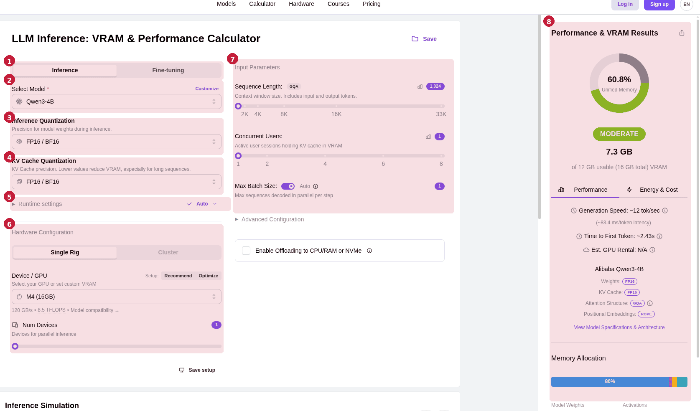

The page has two tabs at the top of the form, a left-hand form, and a results column on the right.

1. **Inference / Fine-tuning tabs.** Inference is the default, and is what you use to size a chat or API workload. Fine-tuning retitles the page to "Full Fine-tuning: VRAM Calculator" and adds training-only fields. See [the Fine-tuning tab](#the-fine-tuning-tab) below.
2. **Select Model.** The model whose memory you are estimating.
3. **Inference Quantization.** Precision of the model weights during inference.
4. **KV Cache Quantization.** Precision of the key/value cache, which grows with sequence length and concurrent users.
5. **Runtime settings.** Collapsed by default, with Auto selected. Open it to set prefill behaviour.
6. **Hardware Configuration.** Single Rig or Cluster, the device, and how many devices.
7. **Input Parameters.** Sequence length, concurrent users, and max batch size.
8. **Performance & VRAM Results.** The ring, the status badge, gigabytes used, speed estimates, and the memory breakdown.

Advanced Configuration sits under the input column (speculative decoding and offloading). It is easier to read in the close-up later on this page.

Ollama's own memory use will be close, not identical. Ollama also applies `OLLAMA_KV_CACHE_TYPE`, Flash Attention, and a default context that depends on available VRAM. Treat the calculator as a planning tool, then confirm with `ollama ps` on your machine.

## Select Model

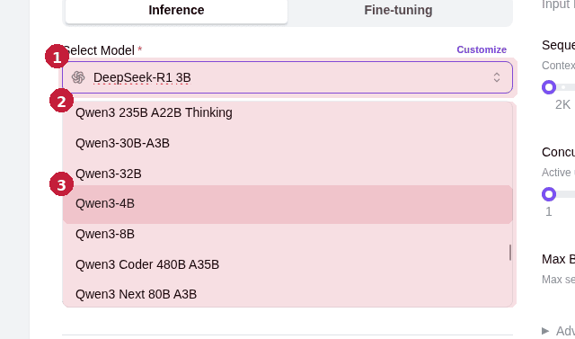

1. The **Select Model** combo (this capture still has DeepSeek-R1 3B selected in the closed field).
2. The scrollable list. Search or scroll; the catalog had 301 models when these shots were taken.
3. **Qwen3-4B**, the model used in the reference setup. Pick the exact family and size you plan to run, not a cousin with a similar name.

The calculator also has a **Customize** link if you need to enter a model that is not in the list. For this workshop, stay on a listed Qwen 3 or Qwen 3.5 size first.

The results column updates as soon as you change the model. A 4B and a 32B of the same family are a different job entirely, which is why the insufficient example later on this page swaps only the model.

## Inference Quantization

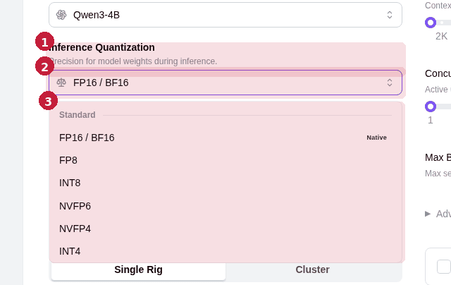

1. The **Inference Quantization** heading. The hint under it reads "Precision for model weights during inference."
2. The closed combo. The reference setup uses **FP16 / BF16**.
3. The open list. Under the **Standard** group you will see:

   - **FP16 / BF16** (native 16-bit)
   - **FP8**
   - **INT8**
   - **NVFP8**
   - **NVFP4**
   - **INT4**

Lower precision shrinks weight memory and usually lowers quality a little. On Apple Silicon, start with FP16/BF16 for a small model that already fits, and move to INT4 or an MLX 4-bit build when a larger model will not fit in 16 GB. NVIDIA-specific formats (NVFP8, NVFP4) apply to newer NVIDIA GPUs; they will not change what an M4 can do.

Ollama GGUF tags such as `Q4_K_M` or `q8_0` are a different naming scheme. When you size for Ollama, treat INT4 as the same ballpark as a 4-bit GGUF, and INT8 as the same ballpark as `q8_0`. Then confirm on the machine.

## KV Cache Quantization

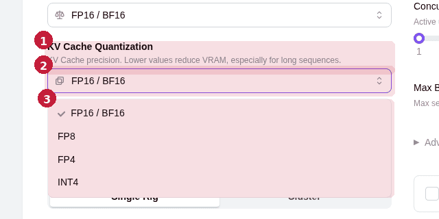

1. The **KV Cache Quantization** heading. The hint reads "KV Cache precision. Lower values reduce VRAM, especially for long sequences."
2. The closed combo. The reference setup uses **FP16 / BF16**.
3. The open list:

   - **FP16 / BF16**
   - **FP8**
   - **FP4**
   - **INT4**

The KV cache stores keys and values for every token in the current context, for every active user. It is often the piece that blows a "the model file is only 7 GB" plan, once you raise sequence length or concurrent users.

In Ollama, the closest control is `OLLAMA_KV_CACHE_TYPE`, which accepts `f16`, `q8_0`, or `q4_0`. `q8_0` is the usual first step when a long context will not fit.

## Runtime settings

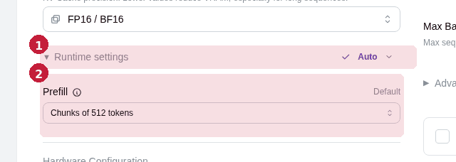

1. **Runtime settings**, collapsed to a single row, with **Auto** selected on the right.
2. Open the row and you get **Prefill**, here set to **Chunks of 512 tokens**, plus a Default control.

Leave Auto alone unless you are modelling a specific prefill policy. Prefill is the phase where the model reads the prompt, before it emits the first new token. Chunk size changes time-to-first-token more than the weight footprint.

## Hardware Configuration

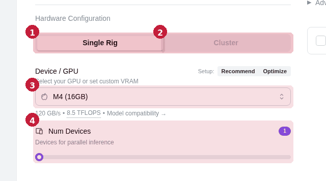

1. **Single Rig.** One machine, which is what almost every workshop laptop uses.
2. **Cluster.** This control is **disabled for Apple devices**. The Cluster tab is greyed out on an M4. It becomes available when you pick a discrete GPU that the calculator can treat as a multi-node setup.
3. **Device / GPU.** Here, **M4 (16GB)**. The line under the combo reports bandwidth and TFLOPS for that device, plus a model-compatibility note.
4. **Num Devices.** On Apple Silicon the label is **Num Devices**. On a discrete NVIDIA or AMD card the same slider is labelled **Num GPUs**. The value is 1 in the reference setup.

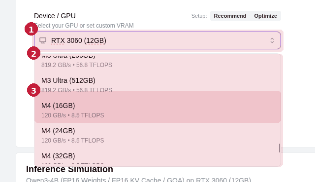

1. The closed **Device / GPU** combo.
2. The device list. The catalog had 143 devices in these screenshots.
3. **M4 (16GB)**, the reference device.

Pick the closest match to the machine you will actually use. A 16 GB M4 and an RTX 3060 12 GB are not interchangeable: the Mac number is unified memory, and the calculator already reports usable memory as 12 GB of 16 GB total on the M4.

Recommend and Optimize, on the right of the device label, will suggest a device or a setup. Useful when you are shopping. Ignore them when you already know the laptop in your bag.

## Input Parameters

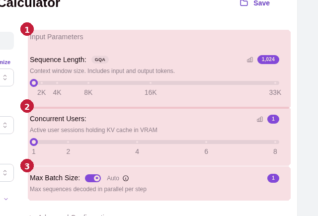

1. **Sequence Length.** The hint reads "Context window size. Includes input and output tokens." The reference setup is **1,024**. The slider runs from 2K ticks up to 33K in this view, and you can type a value on the right. This is the full window you want to reserve, prompt plus completion, not just the prompt.
2. **Concurrent Users.** "Active user sessions holding KV cache in VRAM." The reference setup is **1**. Each extra user keeps its own KV cache resident, so this number scales cache memory almost linearly.
3. **Max Batch Size**, with the **Auto** switch on. Auto is the right starting point. A manual cap matters when you are modelling a server that packs many short requests into one forward pass.

If you plan to use a coding harness, set sequence length to 32,768 or 65,536 and watch the ring. A 4B model that looks comfortable at 1,024 tokens can get tight at 64K, especially with more than one user.

## Advanced Configuration

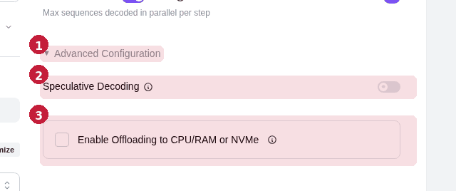

1. **Advanced Configuration**, a disclosure in the input column.
2. **Speculative Decoding**, a toggle (off in the reference setup). Speculative decoding uses a smaller draft model to propose tokens that the main model then verifies. It can raise tokens per second. It also adds some memory for the draft model. Leave it off unless you know you will run a draft model in production.
3. **Enable Offloading to CPU/RAM or NVMe.** Off in the reference setup. Turning this on tells the calculator to assume weights or cache can spill off the GPU. That can make an oversized model "fit" on paper, at a steep speed cost. Ollama already spills onto CPU when VRAM is short, which is what `ollama ps` reports as a CPU/GPU split. If you need offloading to make the numbers work, prefer a smaller model or a lower quantisation instead.

## Results that fit

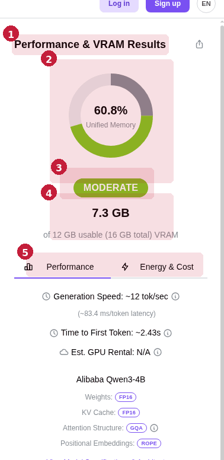

1. **Performance & VRAM Results**, the heading of the right-hand column.
2. The ring. In the reference setup it reads **60.8% Unified Memory**. On a discrete GPU this label is usually **VRAM**.
3. The status badge, here **MODERATE** (green). Other badges you will see include **OKAY** and **INSUFFICIENT**.
4. The headline usage: **7.3 GB** of **12 GB usable (16 GB total) VRAM**. The M4 has 16 GB of unified memory, and the calculator treats 12 GB as the usable budget for the model.
5. **Performance** and **Energy & Cost** tabs.

The Performance tab reports:

- **Generation Speed**, about 12 tok/sec in this capture, with a latency of about 83.4 ms/token.
- **Time to First Token**, about 2.43 seconds.
- **Est. GPU Rental**, N/A on a local Apple device.

These are estimates. Your tokens per second will move with thermal limits, other apps, and the backend (Ollama MLX vs GGUF, LM Studio, and so on). The memory figure is the one to trust first.

Below the metrics, the panel lists the selected model (Alibaba Qwen3-4B) and the assumed architecture flags: weight precision, KV cache precision, attention structure (GQA here), and positional embeddings (RoPE).

### Memory Allocation

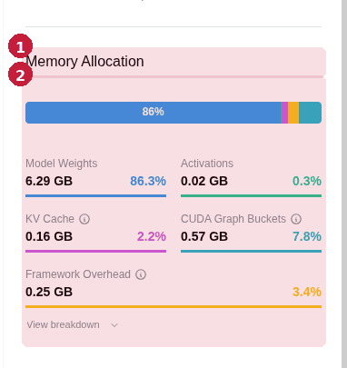

1. **Memory Allocation**, the heading at the bottom of the results column.
2. The stacked bar and the numeric breakdown. In the reference capture:

   - **Model Weights** 6.29 GB (86.3%)
   - **Activations** 0.02 GB (0.3%)
   - **KV Cache** 0.16 GB (2.2%)
   - **CUDA Graph Buckets** 0.57 GB (7.8%)
   - **Framework Overhead** 0.29 GB (3.4%)

   and a "View breakdown" control under the list.

At 1,024 tokens and one user, weights dominate. Raise sequence length or concurrent users and the KV cache slice grows quickly. That is the usual reason a setup that looked fine at 1K tokens fails at 32K.

## When the model does not fit

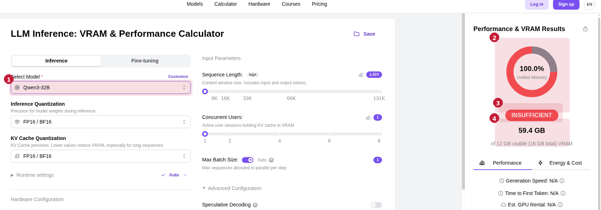

1. The model is now **Qwen3-32B**, still on the same M4 (16 GB), same 16-bit weights and KV, same 1,024-token window.
2. The ring sits at **100.0%**.
3. The status badge is **INSUFFICIENT** (red).
4. The headline usage is **59.4 GB** of 12 GB usable (16 GB total). The job needs roughly five times the memory the machine can give it.

This is the point of the tool. A 32B at FP16 does not fit on a 16 GB Mac, and no amount of hope will change that. The practical next steps, in order:

- Drop to a 4-bit quant (INT4 in this calculator, or a `Q4_K_M` / MLX 4-bit build in Ollama). A 32B at 4-bit is still large for 16 GB once you add cache.
- Use a smaller model in the same family (4B or 9B).
- Shorten the sequence length, or keep concurrent users at 1.
- Move the job to a larger machine.

Turning on CPU/NVMe offloading will change the headline, and the tokens per second will collapse. Check `ollama ps` after you pull anything this close to the limit.

## The Fine-tuning tab

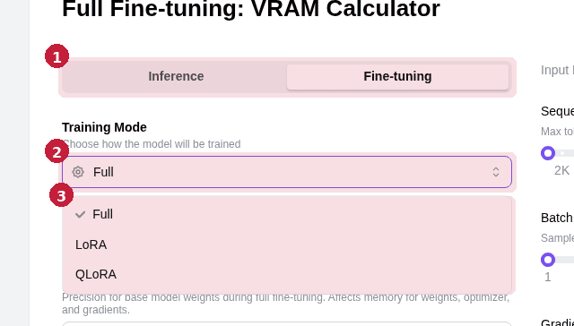

1. The same **Inference / Fine-tuning** tabs, now with Fine-tuning selected. The page title becomes **Full Fine-tuning: VRAM Calculator**.
2. **Training Mode**, here set to **Full**.
3. The open list: **Full**, **LoRA**, and **QLoRA**.

Full fine-tuning stores optimiser states and gradients for every weight. The example in this capture is still Qwen3-32B on an M4 (16 GB), and the results column (out of frame here) reports on the order of **495.8 GB** and **INSUFFICIENT**. That is expected. Full 32B training is a multi-GPU job.

LoRA trains a small set of adapter matrices and keeps the base weights frozen, so the memory drop is large. QLoRA quantises the frozen base (typically 4-bit) and trains the same kind of adapters, which is how a 7B or 8B model can be fine-tuned on a single 16 to 24 GB GPU.

The Fine-tuning tab also adds **Batch Size**, **Gradient Accumulation**, and **Dataset Configuration** (samples, tokens per sample, epochs). Those do not appear on the Inference tab. Use them when you are planning the [Qwen 3.5 demo](../fine-tuning/qwen-finetune-demo/README.md). The demo itself uses LoRA on the 0.8B model, which is a different scale from this 32B full-training screenshot.

For what LoRA and QLoRA mean in practice, and for the Qwen 3.5 caveat on 4-bit QLoRA, see [How fine-tuning works](../fine-tuning/README.md).

## A short working method

1. Open the [calculator](https://apxml.com/tools/vram-calculator).
2. Set **Device / GPU** to the machine you actually have.
3. Set **Select Model** to the family and size you want to run.
4. Set **Inference Quantization** to the precision you will really serve (FP16/BF16, or INT4 if you will pull a 4-bit GGUF).
5. Set **Sequence Length** to the context you need, including the reply. Use 32K or 64K if a coding harness is involved.
6. Set **Concurrent Users** to the number of sessions that will stay loaded at once.
7. Read the ring, the badge, and the Memory Allocation breakdown. If the badge is INSUFFICIENT, change one variable at a time until it is not.
8. After you pull the model in Ollama, run `ollama ps` during a real prompt and compare PROCESSOR, SIZE, and CONTEXT.

## Sources

- [APXML VRAM & Performance Calculator](https://apxml.com/tools/vram-calculator)
- [Ollama FAQ, context length, and KV cache type](https://docs.ollama.com/faq)
